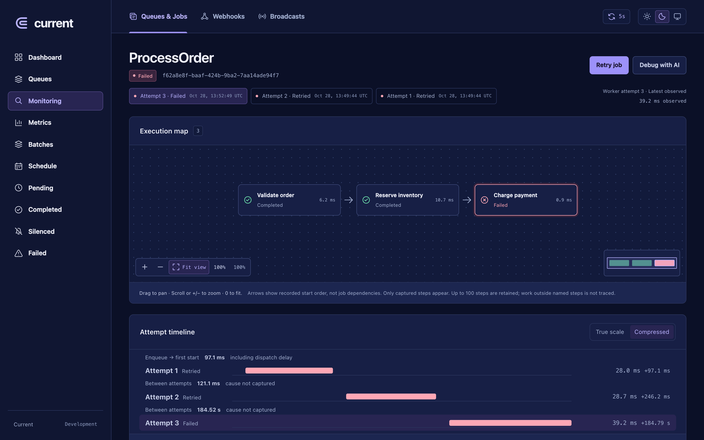
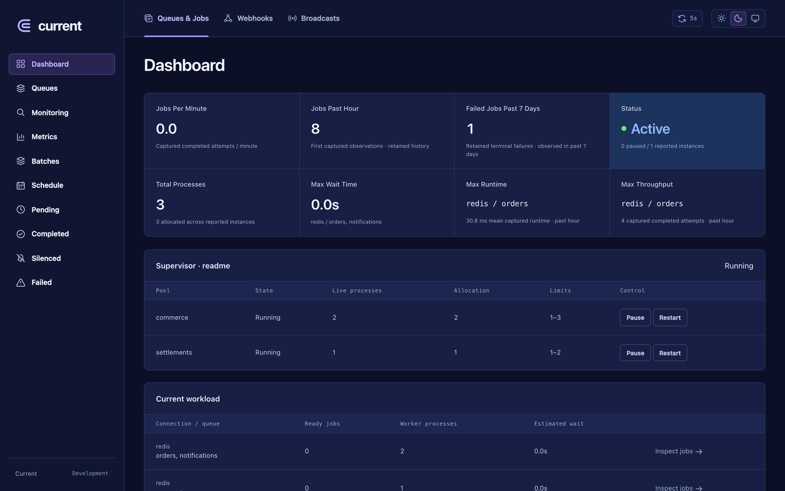
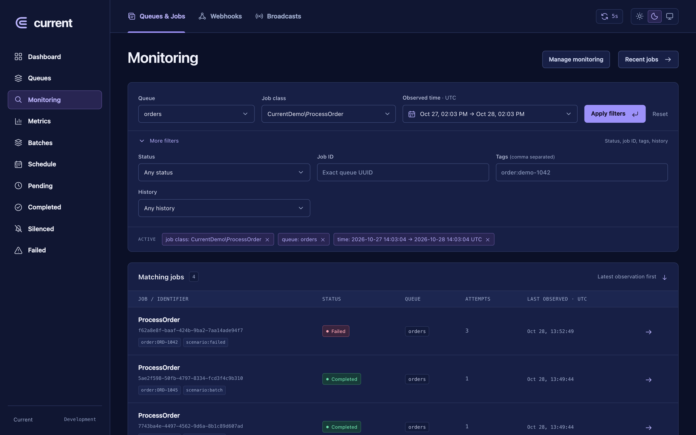
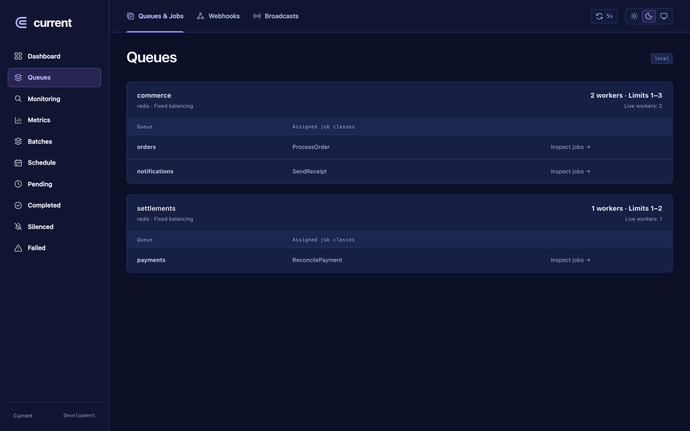
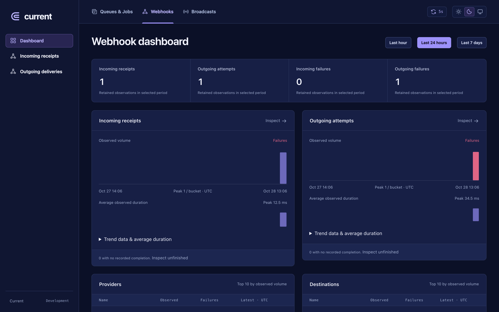
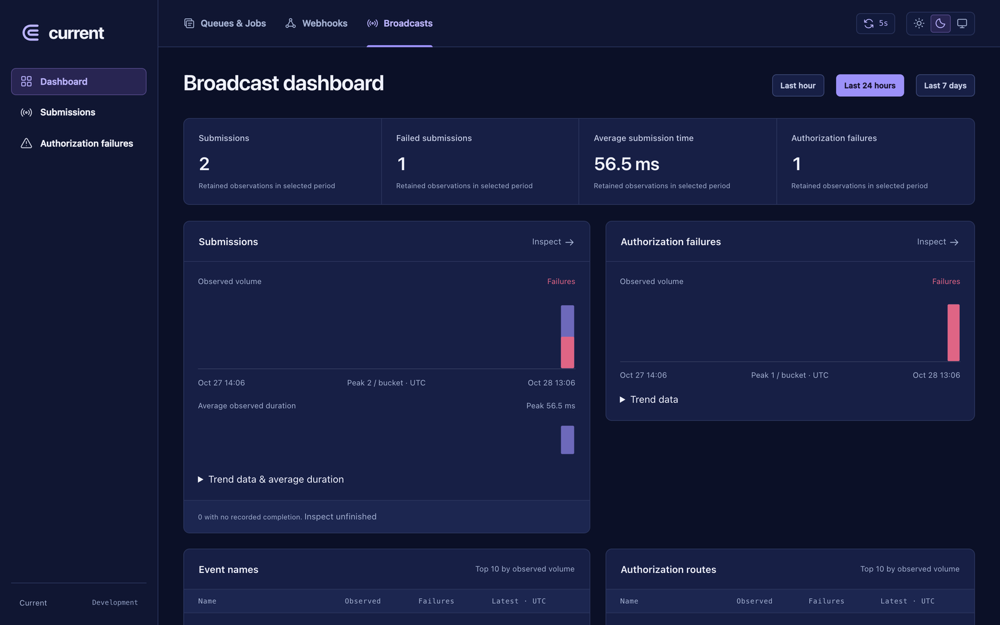

<p align="center">
  
</p>

# Run your queues. Understand every attempt.

Current is a self-hosted dashboard for Laravel jobs, webhooks, and broadcasts. Keep Horizon as your queue engine, or opt into Current’s Go supervisor while Laravel continues to execute your PHP jobs.

Find the right job, follow its attempts and recorded steps, inspect a failure, and navigate to related activity—all inside your application.

**Early beta · MIT licensed · Self-hosted · No frontend build**

> This README describes the development branch, including unreleased improvements. Check the [changelog](CHANGELOG.md) and use the documentation for your installed [release](https://github.com/Gatienorti/current/releases).



*Synthetic demo data. Internal steps require instrumentation.*

## Choose your queue engine

| | Horizon | Current native |
| --- | --- | --- |
| Execution | Your existing Horizon installation | Optional Go supervisor managing standard Laravel PHP workers |
| Queue storage | Laravel Redis queues | Laravel Redis queues |
| Current dashboard | Investigation alongside Horizon | Investigation and native queue operations |
| Setup | Default backend | Explicit opt-in; Linux; experimental |

Current’s native backend includes worker pools and ranges, balancing, supervisor inventory, pause/resume, deployment shutdown, job retries, monitored tags, queue maintenance, metrics, and batches. It keeps Laravel’s job execution semantics. Read the [native setup and support boundaries](docs/NATIVE-ENGINE.md) before switching an application.

**Telemetry is a separate choice.** Recording is synchronous by default. The optional Redis transport and Go collector batch job, attempt, and step writes outside PHP workers. You can use async recording with **either** queue engine. See [async telemetry setup](docs/ASYNC-TELEMETRY.md).

## What you get

- **Dashboard and queue architecture.** See supervisor status, consuming capacity, configured worker ranges, shared queue allocation, and declared job routing. Browse registered schedules alongside queue metrics and batches.
- **Combined job filters.** Search by queues, job class, ID, tags, outcome, exception, and time range. Keep common filters compact and expand the rest when needed.
- **An investigation page for each job.** Switch between attempts, follow an execution map with pan/zoom, inspect step timings and exception context, and read redacted Args and Metadata.
- **Attempt timelines and execution settings.** Compare attempts with compressed or true-scale spacing. Inspect captured retries, timeouts, backoff, and Redis reservation settings, with their sources and relevant configuration warnings.
- **Guarded operations.** Retry failed jobs and batches. Native mode adds monitored-tag management, queue and failed-history maintenance, and operator controls with explicit access gates.
- **Webhook visibility.** Browse incoming receipts and outgoing Laravel HTTP deliveries, inspect outcomes and explicit retry groups, and follow recorded links to jobs.
- **Broadcast debugging.** Inspect Reverb or Pusher submissions, queued/immediate execution, authorization failures, snapshot differences, and related jobs.

Copy a **Debug with AI** prompt assembled from captured failure evidence into your coding agent. Current does not send it to an AI service automatically.

Light, dark, and system appearance are included. Data refreshes every five seconds by default, with pause and interval controls.

<details>
<summary><strong>More screenshots</strong></summary>

### Dashboard



### Monitoring



### Queues



### Webhooks



### Broadcasts



All screenshots use synthetic demo data.

</details>

## Get started with Horizon

For an application already using Horizon:

```sh
composer require gatienorti/current:^0.1.0@beta
php artisan current:install
```

Open **`/current`** while signed into an account allowed by your application’s Horizon access policy. The installer publishes configuration and creates a dedicated SQLite history store without changing your application’s default database.

Restart long-lived workers after installation and keep Laravel’s scheduler running for pruning. Run `current:install` after upgrades as well. Async upgrades require the [documented drain, migration, and restart sequence](docs/ASYNC-TELEMETRY.md).

**Requirements:** PHP 8.2+, Laravel 11.44/12/13, and a compatible Horizon 5.30+ version within 5.x. Laravel 13 requires PHP 8.3+. See [tested version pairs and database support](docs/COMPATIBILITY.md).

No hosted account, Node build, or application WebSocket server is required for the jobs dashboard. Native execution and async recording each require their matching Linux binary and additional setup:

- [Install and configure Current](docs/INSTALLATION.md)
- [Use the native engine without Horizon](docs/NATIVE-ENGINE.md)
- [Enable the optional async collector](docs/ASYNC-TELEMETRY.md)

## Record what happens inside a job

Queue lifecycle, attempts, and supported job snapshots are collected automatically. To see internal operations on the execution map, wrap meaningful work:

```php
use Current\Current;

public function handle(): void
{
    Current::step('Validate order', fn () => $this->validateOrder());
    Current::step('Reserve inventory', fn () => $this->reserveInventory());
    Current::step('Charge payment', fn () => $this->chargePayment());
}
```

Callbacks keep their normal return values and exception behavior. Current records each named step’s timing and outcome. Arrows show recorded start order; they do not infer dependencies.

Supported new object dispatches capture bounded, redacted job properties and standard metadata. Configure explicit `currentArguments()` and `currentMetadata()` exports, or disable automatic snapshots, through [capture configuration](docs/INSTALLATION.md#what-appears-automatically). Historical records are not backfilled.

## Follow webhooks and broadcasts

These integrations are **opt-in**. Configure approved routes, destinations, events, and channels; payload exports require additional configuration.

- [Incoming receipts and outgoing deliveries](docs/INSTALLATION.md#4-enable-optional-integrations)
- [Reverb and Pusher observation](docs/INSTALLATION.md#optional-reverb-broadcast-observation)

Current observes your existing integrations. Signature validation, delivery, broadcaster authorization, and client receipt remain the application’s responsibility. Webhook and broadcast history writes remain synchronous.

## Know what the evidence means

- Collection starts when enabled, with seven-day retention by default. Missing observations remain unknown.
- Internal steps require instrumentation. Static source outlines show possible calls, not proof that those calls ran.
- An exception location shows where an error surfaced; it does not establish root cause. Worker completion and HTTP success do not prove downstream business success or client receipt.
- Queue architecture combines configuration and bounded static inspection. Dynamic routing can remain unresolved. Schedule lists describe registered tasks, not scheduler execution health.
- Redaction happens before persistence. Review capture policies for your business data and protect dashboard access with your application’s gates.

The native engine and async collector are optional, with documented Linux, Redis, and database boundaries. Compatibility and isolated integration tests provide evidence for those boundaries; broad production reliability and universal performance gains are not claimed.

## Documentation and contributing

[Installation](docs/INSTALLATION.md) · [Native engine](docs/NATIVE-ENGINE.md) · [Async telemetry](docs/ASYNC-TELEMETRY.md) · [Compatibility](docs/COMPATIBILITY.md) · [Changelog](CHANGELOG.md)

Contributions and sanitized reproductions are welcome. See [Contributing](CONTRIBUTING.md) and [Security reporting](SECURITY.md). Keep credentials, real payloads, and customer information out of public issues.

Current is an independent project, not an official Laravel product. Released under the [MIT license](LICENSE).
